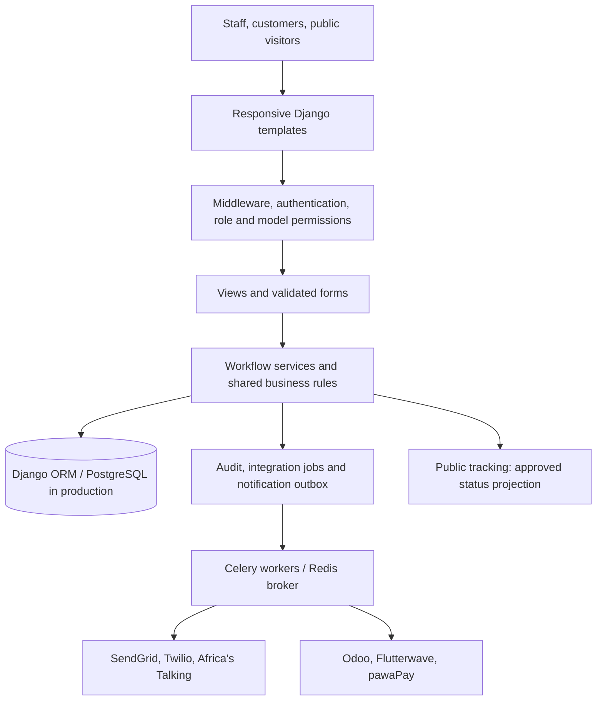

# NASIL Supply & Logistics — Current Architecture

Reviewed 14 November 2026. NASIL is a server-rendered Django modular monolith.
The descriptions below reflect the current source tree; deployment configuration
and mock integrations are not evidence of live service acceptance.

## Runtime and boundaries

- `backend/` owns Django configuration, URL routing and Celery setup. SQLite is
  for local development; production settings require PostgreSQL and TLS.
- `accounts/`, `organization/` and `core/` provide users, employee/organization
  records, shared permissions, business rules and audit models.
- `logistics/`, `customers/`, `quotations/`, `shipments/` and `dashboard/` cover
  public intake, customer records, quote pricing/approval, shipment transitions
  and staff summaries.
- `operations/` provides shared screens, reports, export/proof handling, policy
  settings and the legacy inventory ledger. `inventory/` builds the catalogue,
  warehouse links and reservations on those existing records.
- `orders/`, `procurement/` and `fleet/` implement order/purchase approval,
  stock fulfillment/receiving, shipment assignment and manual route checkpoints.
- `payments/` owns invoices; `finance/` owns payments and reconciliation.
  `integrations/` contains the Odoo, Flutterwave and pawaPay adapters and jobs.
- `customer_services/` owns registration, customer portal, redacted public
  tracking and transactional notification outbox. `security_controls/` owns MFA,
  session controls, input guards and security event logging.
- `templates/` and `static/` provide the server-rendered responsive interface.
  This is not a native mobile app or a general-purpose REST API.

## Data and service ownership

`finance.Invoice` is a proxy for `payments.Invoice`; it is one invoice table.
`inventory.Warehouse` proxies `organization.Warehouse`. Catalogue stock levels
connect to the established `operations.InventoryItem` ledger. These compatibility
layers do not create parallel balance or invoice sources.

Views authorize and validate requests, then delegate state changes to services.
Services use Django transactions, record locks/version checks, idempotency,
database constraints and shared transition/approval rules. Business audit records
and outbox/integration jobs are stored in the database. Signals connect selected
workflows and enqueue effects; provider calls are handled by Celery tasks, not by
the database transaction itself.

The principal flow is quotation → approval → shipment. Orders may reserve stock,
fulfill and link a shipment; approved purchases receive stock through the same
ledger. Shipment assignment checks fleet/driver readiness. Invoice and supplier
payment records feed reconciliation and optional Odoo exports. Public tracking
returns a limited shipment timeline and delivery confirmation; private audit data
and evidence downloads require authorization.

## External services and deployment

SendGrid, Twilio and Africa's Talking; Odoo JSON-2; Flutterwave; and pawaPay adapters
exist with durable queue/retry behavior. Live provider acceptance, business account
configuration, supervised worker operation and end-to-end reconciliation remain
deployment/operations tasks. A Redis broker URL alone does not run Celery workers
or beat.

Runtime dependencies are in `requirements.txt`; Linux Gunicorn deployment uses
`requirements-production.txt`; development/security tools are separate. Vercel
uses Django framework discovery and the runtime dependency file. Nginx/Gunicorn
examples are in `deploy/` and `DEPLOYMENT.md`. Both are deployment options, not
proof of a currently running or production-accepted system.

Delivery-proof bytes are stored in a database `BinaryField` and served by
permission-checked views. Logos and staff photos use filesystem-backed
`ImageField`s; production requires durable private media storage and a delivery
policy. Database storage for proof files requires backup and capacity planning.

## Important current limits

- Staff permissions are organization-wide. Branch-level row isolation is not
  implemented.
- Fleet tracking is staff-entered checkpoint history, not a live GPS feed.
- Finance provides invoices, payments and statement reconciliation, not a full
  general ledger. Payment reversal is distinct from a provider refund.
- Odoo export creates/checks draft documents, not autonomous accounting postings.
- Partial/split fulfillment, returns, settlement fees/refunds, live delivery
  receipts, public REST APIs and advanced warehouse/route features need further
  business design and implementation.
- PostgreSQL concurrency, provider sandbox behavior, persistent private media,
  backups/restore, monitoring and production access policies still need staging
  acceptance before real operational use.
